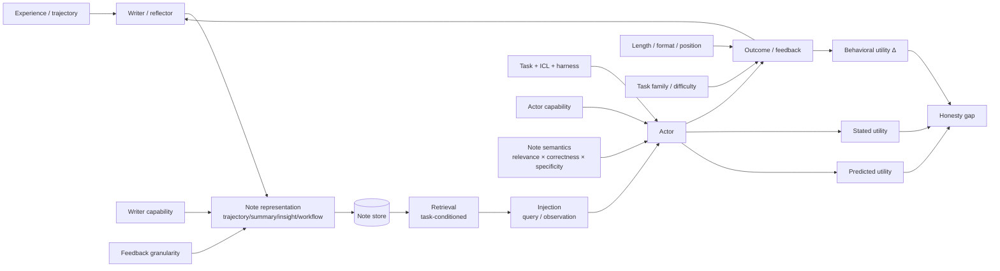

# 笔记作为干预：一个可测量的概念模型
### Note Semantics & Utility · Conceptual Model v0.1

> 目的：把"笔记有没有用"从一个模糊的经验问题，变成一个可定义、可操纵、可测量的因果问题。  
> 适用范围：Reflexion / ExpeL / AWM / ACE / JITMem 这一类"从经验写自然语言、存起来、后续注入"的 agent memory；不覆盖纯参数化记忆（LoRA/RL）作为主对象，但把它作为表示谱的一端。

---

## 1. 六个定义

| 概念 | 定义 | 关键区分 |
|---|---|---|
| **Note（笔记）** | 从经验中提取、存放在模型外部、在未来上下文中注入以条件化行为的自然语言文本 | 不是每步 `Thought`，不是 1-shot ICL 示范，不是完整 trajectory |
| **Note semantics（笔记语义）** | 笔记的意义属性，而非表面长度/格式 | 三维：relevance × correctness × specificity；扩展：sufficiency、confidence、provenance |
| **Behavioral utility（行为效用）** | 固定 harness 下，带笔记与等长/等格式对照笔记的配对结果差 Δ | 因果量，不是相关系数 |
| **Stated utility（陈述效用）** | actor 用完后对"这条笔记有没有帮助"的自我报告 | 事后 |
| **Predicted utility（预测效用）** | actor 用之前对"这条笔记会不会有帮助"的预测 | 事前 |
| **Honesty gap（诚实差距）** | stated/predicted 与 behavioral 的解耦 | 不是"撒谎"，是元认知校准失败 |
| **Confabulation（混淆）** | 自信但错误/不可验证的笔记内容被写入、保留并跨 trial 使用 | 与单次 hallucination 不同：持久、自我强化 |
| **Sufficiency（充分性）** | 笔记是否包含当前任务所需的信息，而不仅仅是"相关" | relevance ≠ sufficiency |

---

## 2. 三轴表示空间

任何一条笔记都可以放在三个正交轴上。你的"correctness × specificity 矩阵"是这个空间在**固定 relevance** 处的一个切片。

### Axis 1 — Abstraction / specificity（表示粒度）

```text
raw trajectory → summary → insight / principle → workflow / skill → parameter (LoRA)
   最具体                                                          最抽象
```

ALFWorld 例子（同一个 `pick_and_place` 经验）：

| 粒度 | 笔记 |
|---|---|
| Trajectory | "In cabinet 2 I found spraybottle 2; I opened it, took the bottle, went to toilet 1, and put it there." |
| Summary | "I searched cabinets and found the target in cabinet 2." |
| Insight | "Check closed containers before concluding an object is absent." |
| Workflow | "Scan receptacles → open closed containers → take target → go to target receptacle → place." |
| Meta-plan (MPO) | "For pick-and-place: locate the target first, then the destination; open closed containers; carry one object at a time."（per-family，DPO 优化） |
| Parameter | LoRA trained on successful `pick_and_place` trajectories. |

**文献结论**：抽象程度决定跨任务可迁移性。Memory Transfer Learning (Kim et al. 2026, arXiv:2604.14004) 在 coding agents 上测得 trajectory +1.1%、workflow +1.5%、summary +2.3%、insight +3.7%；低层 trace 会造成 negative transfer。Hu et al. 2026 (arXiv:2604.27003) 在 ALFWorld/BabyAI 上发现 abstract procedural memory 比 raw trajectory 更可靠，且 negative transfer 集中打击 hard cases。ACE (Zhang et al. 2026, arXiv:2510.04618) 的 brevity bias / context collapse 是这个轴的失败模式。

**但抽象不是单调更好**："What Is This Memory Useful For?" (Yang et al. 2026, arXiv:2611.03930) 发现 task-blind summary/structured record 在固定 context size 下反而不如 raw memory，因为压缩丢掉了 answer-bearing 信息。所以 Axis 1 与 Axis 3 有交互：**抽象提高 transfer，但降低 sufficiency**。

### Axis 1b — Scope（适用范围）

抽象程度之外，还有一个正交维度：**这条笔记/计划适用于多大的任务集合**。

| Scope | 例子 | 代表工作 |
|---|---|---|
| **Per-episode** | 一次失败 trial 后写一条 reflection，重置同一任务再用 | Reflexion |
| **Per-task** | 针对某个具体 task instance 写一条 note | Kim 2026；Honest Lying |
| **Per-task-family** | 一个 `pick_and_place` 的 meta-plan / workflow，服务该族所有任务 | **MPO**；AWM |
| **Global** | 跨任务的 playbook / system prompt / 参数 | ACE；Agent-FLAN；LoRA |

**为什么重要**：scope 决定 relevance/sufficiency 的基线。
- **Per-task** 更具体、更容易 answer-bearing（sufficient），但更容易 negative transfer / overfitting 到单条轨迹。
- **Per-family** 更抽象、更可迁移，但更容易 insufficient；MPO 的 meta-plan 就属于这一格。
- **Global** 最可迁移，但也最泛；ACE 的 brevity bias 是这一格的典型失败。

MPO 的 meta-plan 是 **per-family、离线 DPO 优化** 的 note；你的 2×2 是 **per-task、受控注入** 的 note。两者不是同一个 scope，不能直接互相替代；但 MPO 的 meta-plan 可以作为你 Phase 2 的**强 baseline**（"优化过的 per-family note"）。

### Axis 2 — Correctness / faithfulness

```text
correct → partially correct → wrong → confabulated
```

- Kim 2026：同一条"相关"笔记可帮 XOR、害 AND；内容特定，不是"有笔记就好"。
- Honest Lying (Dixit et al. 2026, arXiv:2605.29463)：16 个 frozen ALFWorld 环境中 0/121 条反思提到正确目标物体；2/16 是 memory-harmful，14/16 是 task-hard。
- Zhao et al. 2026 (arXiv:2610.22984)：failure-only evolution 会产生 false-success attribution、misattribution、distorted consolidation、harmful guidance；即使只保留 verified-correct experience，也仍然过度绑定 source trajectory。
- Huang et al. 2024 (arXiv:2310.01798)：没有外部 oracle 的 self-correction 会降性能；约 70% 错误来自 verification，而不是 reflection。

### Axis 3 — Task-conditioned relevance / sufficiency

```text
irrelevant → relevant but insufficient → answer-bearing / sufficient
```

- Kim 2026 的 Mjunk（等长无关笔记）≈ 无笔记（27 vs 27），说明 irrelevant 是负控制，不是"待检验的效应"。
- "What Is This Memory Useful For?" 把 utility 定义成 **task-conditioned**：同一条 memory 对不同任务的价值不同；只有 answer-bearing 的 memory 才稳定带来 +0.33 paired reward gain。
- "From Relevant Memories to Sufficient Evidence" (arXiv:2610.22668)：relevance ≠ sufficiency；检索到相关片段不等于构成证据集。
- "Diagnosing Retrieval vs. Utilization Bottlenecks" (arXiv:2603.02473)：retrieval precision 与 accuracy 相关 r=0.98，检索质量比 write strategy 更主导。

### Moderators（不是轴，但会改变效应符号/大小）

| Moderator | 证据 |
|---|---|
| Writer capability | ExpeL：更好的 insight LLM 有帮助；AgentBrew：teacher 写 student-aware note，且必须经 student recovery 认证 |
| Actor capability | MemoryTax (arXiv:2610.29823)：memory scaffold 帮弱模型，不帮强模型 |
| Feedback granularity | Honest Lying：binary feedback → frozen/confabulated；unit test/programmatic feedback → RRR 0.64→0.10 |
| ICL / harness | 我们的 134 任务：1-shot 76.87% vs 0-shot 70.15%（−6.72pp，p=0.12）；note 与 ICL 可能互相替代 |
| Task family / difficulty | Hu 2026：negative transfer 集中 hard cases；我们的 ALFWorld：look_at 44%、two-object 41%，其余 80–96% |
| Length / format / position | 必须匹配，否则测到的是 salience/length，不是 semantics |
| Provenance | self / teacher / human；self 的 confabulation 风险最高 |
| Confidence | Hindsight (arXiv:2512.12818) 给 opinion 节点带 confidence，可作为 utility 预测特征 |

---

## 3. 生命周期：note 作为一条可干预的管线

```text
Experience → Writer → Representation → Store → Retrieve → Inject → Actor → Outcome → Feedback → Update
```

| 阶段 | 设计选择 | 典型失败 |
|---|---|---|
| Experience | 成功/失败轨迹、反馈类型、任务族 | 失败诊断错误、false success |
| Writer | 同模型 / 更强 teacher / 人类；是否 student-aware；是否用偏好对/DPO 优化（MPO） | confabulation、over-generalization、brevity bias |
| Representation | trajectory / summary / insight / workflow / skill / parameter | 过具体→negative transfer；过抽象→insufficient |
| Store | append-only / edit / dedup / confidence / provenance | 错误累积、重复、staleness |
| Retrieve | BM25 / embedding / graph / task-conditioned | retrieval miss、retrieval diversity collapse |
| Inject | query / observation / position / template / length | salience 混淆、context 膨胀 |
| Actor | 能力、ICL、context、note following | 不跟随、盲目跟随、sycophancy |
| Outcome | binary / unit test / progress / LLM judge | 反馈粒度过粗、judge 噪声 |
| Feedback | verifier / oracle / self-grade | reward inflation（Echo Gap, arXiv:2608.00017） |
| Update | rewrite / consolidate / forget | context collapse、distorted consolidation |

---

## 4. 因果 DAG



**读法**：
- 你的主因果边是 `N → A → O`，即"笔记语义 → actor 行为 → 结果"。
- `C → N` 和 `F → N` 是 writer 侧的上游原因；`M → A`、`T → A` 是 actor 侧 moderator。
- `L → O` 和 `TF → O` 是必须控制的混淆/异质性与。
- `ST`、`PR`、`U` 是三个不同的 utility 测量，不要混为一个"note quality"。

---

## 5. 测量模型

### 5.1 估计量

对任务 \(i\) 和笔记 \(n\)：

\[
\Delta_i(n) = Y_i(n) - Y_i(\text{control}_i)
\]

- \(Y_i\)：success（0/1）或 trials-to-solve / steps。
- \(\text{control}_i\)：**等长、等格式、同位置**的 filler note（N2），不是"无笔记"。
- 配对单位：同一个 task、同一个 seed、同一个 harness。
- 主估计量：note-level 平均 \(\bar{\Delta}\)，以及 \(\Delta\) 的分布。

### 5.2 Help / inert / harm 三分

| 类别 | 定义 | 报告 |
|---|---|---|
| Help | \(\Delta > 0\) | 比例、平均增益 |
| Inert | \(\Delta = 0\) | 比例 |
| Harm | \(\Delta < 0\) | 比例、harm rate on otherwise-solvable tasks |

**关键**：只报条件均值会掩盖"少数笔记大幅帮助、少数笔记大幅伤害"的分布。Kim 2026 的三条 replication chains（1/48 到 46/48）就是 note-level 方差。

### 5.3 Honesty gap

- **Stated**：用完后问"这条笔记有帮助吗？"（是/否/不确定，或 5 点）。
- **Predicted**：用之前问"你预计这条笔记会有帮助吗？"。
- **Behavioral**：\(\Delta\)。

三个候选指标：
1. **Dissociation rate** = \(P(\text{stated helpful} \mid \Delta < 0) + P(\text{stated unhelpful} \mid \Delta > 0)\)。
2. **Calibration**：predicted utility 对 \(\Delta\) 的 AUROC / Brier / ECE。
3. **Echo gap**：self-graded utility 与外部 behavioral utility 的差（参考 Memory Reward Inflation, arXiv:2608.00017）。

### 5.4 Sufficiency 的操作化

- 预先标注每个 (task, note) 对：note 是否包含 answer-bearing 信息（sufficient）、只相关（relevant-insufficient）、无关（irrelevant）。
- 比较三类的 \(\Delta\)。
- 这比"relevance"更接近 "What Is This Memory Useful For?" 的 task-conditioned utility。

### 5.5 控制与功效

必须锁死：length、format、position、feedback granularity、ICL、model、max steps、parser、task difficulty。

功效：134 个任务对约 7pp 的配对差异**不够**（我们的 0-shot vs 1-shot：−6.72pp，McNemar p=0.12）。note-level 方差通常大于条件均值差。建议：
- Phase 1 在 35 个 hard tasks 上做 **within-task 多 note** 设计；
- 或全 134 + 多 note / 多 seed；
- 或 274（140 seen + 134 unseen）。

---

## 6. 失败模式地图

| 失败 | 机制 | 代表工作 |
|---|---|---|
| Confabulation | 错误诊断被写入并复用 | Honest Lying |
| Misattribution | 把失败归因到错误原因 | Zhao 2026; Kim 2026 |
| False success | 未验证的成功被存储 | Zhao 2026 |
| Distorted consolidation | 重写/压缩丢失条件 | Zhao 2026; ACE |
| Brevity bias | 优化成短而泛的笔记 | ACE |
| Context collapse | 全量重写侵蚀细节 | ACE |
| Negative transfer | 过具体笔记跨任务有害 | Hu 2026; Memory Transfer Learning |
| Retrieval miss | 有用笔记没被检索到 | Diagnosing Retrieval; What Is This Memory Useful For |
| Sufficiency gap | 相关但不构成证据 | From Relevant Memories to Sufficient Evidence |
| Reward inflation | 自评分虚高 | Memory Reward Inflation |
| Blind following | actor 跟随错误笔记 | Honest Lying; Kim 2026 |
| Harness confound | parser/步数/ICL/任务 mix | 我们的 0-shot vs 1-shot；文献 13–75% 跨度 |

---

## 7. 由模型推出的可证伪假设

- **H1（交互）**：wrong-specific 比 wrong-generic 伤害更大；correct-specific 比 correct-generic 帮助更大；correct-generic 接近 inert。
- **H2（方差）**：note-level 效应分布跨任务族剧烈分化；条件均值掩盖它；harm 集中在 hard families。
- **H3（诚实差距）**：predicted/stated utility 对 behavioral utility 的校准差；gap 与 RRR/object-mention 仅弱相关。
- **H4（writer）**：更强 writer 提升 note correctness/specificity，但 student-awareness 与 verification 比原始能力更重要。
- **H5（抽象-充分性权衡）**：抽象提升跨任务 transfer，但降低 answer-bearing sufficiency；task-conditioned utility 在中间粒度最高。
- **H6（ICL 替代）**：1-shot ICL 与 note 是部分替代品；note 效应在 0-shot 下更大。
- **H7（负迁移）**：negative transfer 随 specificity 和 task distance 上升；hard cases 最敏感。
- **H8（scope 权衡）**：per-task note 的 behavioral utility 方差更大（更 sufficient，也更易 negative transfer）；per-family meta-plan（MPO 风格）方差更小、均值更稳，但在 hard families 上可能 insufficient。两者不是替代关系。

---

## 8. 与文献的定位（一句话版）

- **Reflexion / ExpeL / AWM / ACE**：证明"写—存—取—注入"这条管线可以工作，并给出表示形式（reflection / insight / workflow / playbook）。
- **Hu 2026 / Memory Transfer Learning**：证明**抽象程度**决定 transfer，raw trace 会 negative transfer。
- **Kim 2026 / Honest Lying / Zhao 2026**：证明**内容正确性**是独立轴；错误/混淆的笔记会持久伤害。
- **What Is This Memory Useful For? / From Relevant Memories to Sufficient Evidence**：证明**task-conditioned sufficiency**是第三个轴；related ≠ sufficient。
- **AgentBrew / JITMem / When Should Experience Become Parameters**：证明 writer/curator/selection 是独立的设计变量；selection 比 volume 重要。
- **MPO (Xiong et al. 2025)**：证明 per-family meta-plan 可以用 DPO 离线优化，并把 Qwen2.5-7B 推到 71.4/75.4；但它优化的是"任务成功率"，不是 note semantics，也没有 wrong/irrelevant 控制、note-level 方差、honesty gap。它是你 Phase 2 的强 baseline，不是你的核心问题。
- **你的空白**：把这三轴在**同一 harness、匹配长度/格式/位置**下做成可操纵的因果设计，并分离 **stated / predicted / behavioral utility**。这是目前没有被系统做过的组合。
